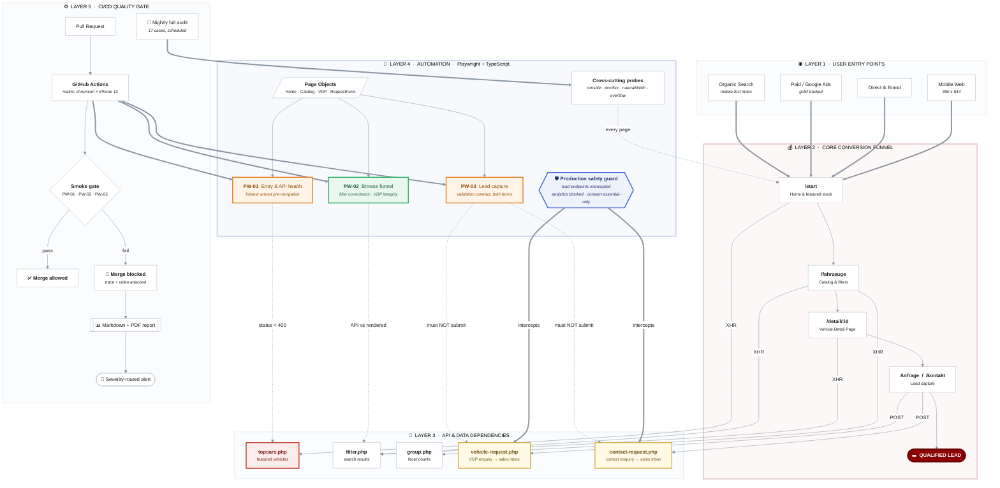

# QA Automation Architecture: autohaus-royal.de

A test strategy organised around the revenue funnel rather than around the
codebase. Every test in the suite answers a business question, and the diagram
below shows which one.

Render the diagram to PNG/SVG with `npm run diagram`. The source of truth is
[`architecture.mmd`](./architecture.mmd).

---

## The strategy in one sentence

Guard the four steps a buyer takes to become a lead, assert the APIs each step
depends on, and block a merge the moment any of them regresses.

## Why layered this way

| Layer | What it holds | Why it is a separate layer |
| :--- | :--- | :--- |
| 1. Entry points | Organic, paid, direct, mobile | Traffic arrives in different shapes. Mobile is a distinct risk surface, not a variant. |
| 2. Conversion funnel | `/start` to `/fahrzeuge` to `/detail/:id` to enquiry | This is the revenue path. Everything else exists to protect it. |
| 3. API dependencies | The five PHP endpoints behind the funnel | Each funnel step has exactly one backend it cannot survive without. Naming them makes failure attribution instant. |
| 4. Automation | Page objects, three funnel tests, cross-cutting probes, safety guard | Tests depend on page objects, never on raw selectors. One markup change costs one edit. |
| 5. CI/CD gate | PR smoke gate plus a nightly production audit | Two different jobs: stop regressions before merge, and catch production rot that no commit caused. |

## The diagram

---

## Reading the colours

| Colour | Meaning | Current occupants |
| :--- | :--- | :--- |
| 🔴 Red | Broken in production right now | `topcars.php` returns HTTP 500 on every homepage load |
| 🟠 Amber | Test currently failing, defect open | PW-01 (API health), PW-03 (email validation) |
| 🟢 Green | Test passing, behaviour protected | PW-02 (browse funnel end to end) |
| 🟡 Yellow | Lead endpoint, intercepted by the safety guard | `vehicle-request.php`, `contact-request.php` |
| 🔵 Blue | Safety infrastructure | Production safety guard |

## Three design decisions worth defending

**1. The API layer is asserted separately from the UI.**
`PW-02` checks the status of `filter.php` *and* the rendered result list, then
compares them. When those two disagree you have found the most expensive class
of catalog bug: the query ran correctly and the UI ignored the answer. A test
that only counts cards cannot tell the difference between that and an empty
inventory.

**2. Response listeners are armed before navigation, never after.**
`topcars.php` fires during initial page load. A listener attached after
`goto()` resolves misses it completely, and the suite reports a healthy
homepage while the merchandising module is dark. This is the single most common
way an automated smoke test lies to you.

**3. The suite cannot create a sales lead, by construction.**
Both lead endpoints are intercepted at the browser-context level and answered
locally with a synthetic 200. The application's success branch still runs, so
the resulting UI state stays assertable, but nothing reaches the dealership.
This matters more than it sounds: the two enquiry forms look identical and share
their markup, but they post to *different* URLs. Guarding only the obvious one
leaves a live path into the sales inbox.

## What the gate costs

| Job | Trigger | Duration | Blocking |
| :--- | :--- | :--- | :---: |
| Funnel smoke gate | Every pull request | Under 2 minutes | Yes |
| Nightly production audit | 04:15 Europe/Berlin | Around 3 minutes | No, reports only |

Both are defined in [`.github/workflows/qa-gate.yml`](../.github/workflows/qa-gate.yml).
The smoke gate is deliberately small. A gate that takes fifteen minutes is a
gate people learn to bypass.
